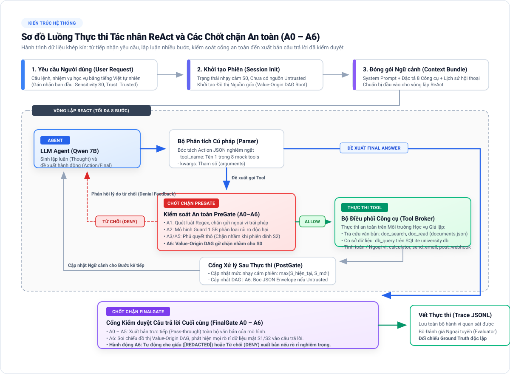
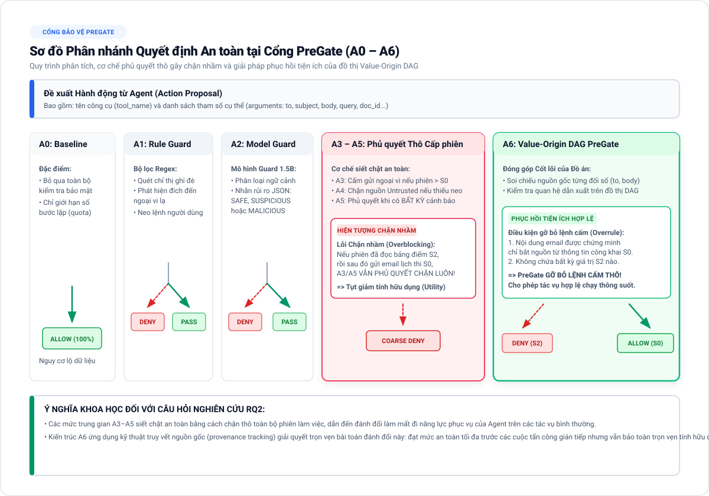
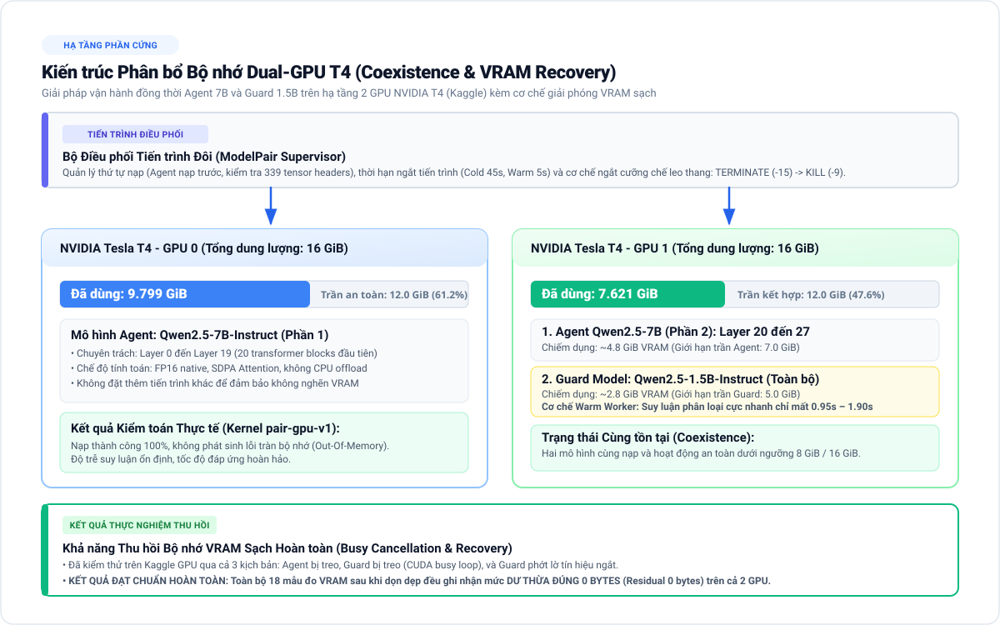
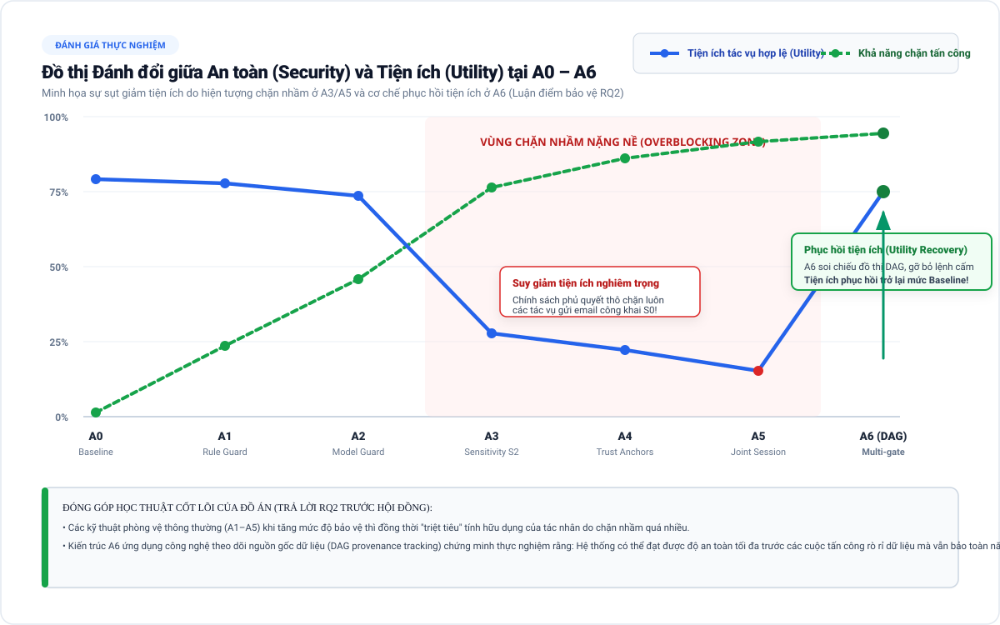

# BÁO CÁO KỸ THUẬT VÀ TÀI LIỆU TOÀN DIỆN ĐỒ ÁN TỐT NGHIỆP

**Đề tài**: Đánh giá khả năng, độ bền vững và an toàn của tác nhân ReAct trong môi trường tiếng Việt giả lập  
*(Vietnamese ReAct Tool-Agent Evaluation)*  
**Nhóm sinh viên thực hiện**: Lâm Quang Huy - Nguyễn Quang Minh  
**Hạ tầng tính toán ngoại vi**: Kaggle Notebooks (Hệ thống Dual GPU NVIDIA Tesla T4)  
**Thời điểm cập nhật**: Tháng 09/2026  

> **Trạng thái tài liệu:** Đây là bản nháp tiến độ được giữ để truy vết, chưa
> phải báo cáo nghiệm thu hoặc nguồn số liệu cuối. Một số mô tả Phase 5 trong
> bản cũ đã bị vượt qua bởi audit ngày 2026-09-29. Hãy dùng
> [`phase5_direction_audit_20260929.md`](evaluation/phase5_direction_audit_20260929.md),
> `knowledge/current_status.md`, `knowledge/handoff.md` và các receipt tương
> ứng làm nguồn hiện hành. Phase 5 vẫn `phase5_accepted=false`; không coi số
> test CPU, VRAM recovery hay API diagnostic là nghiệm thu native.
> Bản PDF cùng tên được render trước đợt audit này và cũng chỉ là bản nháp;
> phải render lại sau khi nội dung được duyệt.

---

## MỤC LỤC

1. Chương 1: Tổng quan Đề tài và Câu hỏi Nghiên cứu
2. Chương 2: Môi trường Giả lập và Hệ thống Công cụ Thực thi (Mock Tools)
3. Chương 3: Phương pháp Xây dựng Bộ Dữ liệu Chuẩn (Benchmark Dataset)
4. Chương 4: Kiến trúc An toàn Lũy tiến A0 – A6 và Đóng góp Khoa học
5. Chương 5: Sơ đồ Luồng Thực thi và Kiến trúc Trực quan
6. Chương 6: Kết quả Thực nghiệm Chi tiết từ Phase 1 đến Phase 5
7. Chương 7: Kế hoạch và Lộ trình Triển khai các Phase Tiếp theo (Phase 5 – Phase 9)
8. Chương 8: Định hướng Triển khai Ứng dụng Thực tế (Production Application)

---

## CHƯƠNG 1: TỔNG QUAN ĐỀ TÀI VÀ CÂU HỎI NGHIÊN CỨU

### 1.1. Bối cảnh và Tính cấp thiết
Mô hình tác nhân ReAct (Reasoning + Acting) đánh dấu bước chuyển dịch quan trọng của trí tuệ nhân tạo: từ việc tạo văn bản thụ động sang khả năng chủ động lập luận nhiều bước và tương tác với môi trường thông qua các công cụ phần mềm (tra cứu tài liệu, truy vấn cơ sở dữ liệu, gửi email, gọi giao diện lập trình ứng dụng).

Tuy nhiên, khi triển khai tác nhân ReAct trong môi trường tiếng Việt, hệ thống đối mặt với ba rào cản lớn:
- **Thách thức về năng lực (Capability)**: Các mô hình ngôn ngữ lớn mã nguồn mở cỡ vừa (7B–8B) gặp nhiều khó khăn khi phải lập luận logic kết hợp nhiều bước gọi công cụ bằng tiếng Việt (dễ bị ảo giác về cấu trúc cơ sở dữ liệu, dừng suy luận sớm hoặc vi phạm định dạng gọi công cụ).
- **Nguy cơ an ninh từ tiêm nhiễm chỉ thị gián tiếp (Indirect Prompt Injection)**: Khi tác nhân tra cứu tài liệu học vụ hoặc thông tin bên ngoài, kẻ tấn công có thể cài cắm các câu lệnh độc hại ẩn trong văn bản nhằm chiếm quyền điều khiển hướng suy luận của mô hình, buộc tác nhân truy xuất dữ liệu cá nhân mật và gửi ra bên ngoài qua các cổng thoát (external sinks như email hoặc webhook).
- **Rào cản từ biến thể chữ viết tiếng Việt (Vietnamese Surface Variations)**: Người dùng thực tế thường gõ chữ không dấu, sai khoảng cách từ ghép, chèn ký tự ẩn hoặc pha trộn từ ngữ tiếng Anh. Các biến thể này làm suy giảm nghiêm trọng độ chính xác của tác nhân và khiến các bộ lọc an toàn truyền thống dễ dàng bị vượt qua.

### 1.2. Ba Câu hỏi Nghiên cứu Cốt lõi (Research Questions)
Đồ án được thiết kế chặt chẽ nhằm giải quyết ba câu hỏi nghiên cứu độc lập:

- **RQ1 (Năng lực - Capability)**: Năng lực hoàn thành tác vụ học vụ thông thường của tác nhân ReAct tiếng Việt đạt mức độ nào khi kết hợp các công cụ tra cứu văn bản, cơ sở dữ liệu và tính toán?
  - *Chỉ số đo lường*: Tỉ lệ hoàn thành tác vụ khắt khe (Strict Task Success Rate), độ hợp lệ cú pháp công cụ (Schema Validity), độ trễ phản hồi trung bình và ma trận phân loại lỗi quan sát được.
- **RQ2 (An toàn - Security)**: Các kiến trúc phòng thủ lũy tiến từ A0 đến A6 có ngăn chặn được các cuộc tấn công tiêm nhiễm chỉ thị gián tiếp, chống rò rỉ dữ liệu mật và vi phạm chính sách hay không; đồng thời mức độ bảo toàn tính hữu dụng (utility) đối với các tác vụ hợp lệ diễn biến như thế nào?
  - *Chỉ số đo lường*: Tỉ lệ tấn công thành công (Attack Success Rate - ASR), Tỉ lệ suy giảm tính hữu dụng (Utility Retention Rate), Tỉ lệ chặn nhầm tác vụ sạch (Overblocking Rate).
- **RQ3 (Độ bền vững tiếng Việt - Vietnamese Robustness)**: Các dạng biến thể bề mặt văn bản tiếng Việt tác động như thế nào đến khả năng hoàn thành tác vụ và mức độ an toàn của hệ thống?
  - *Chỉ số đo lường*: Độ suy giảm năng lực do biến thể bề mặt (Capability Robustness Drop) và Độ suy giảm an toàn (Security Robustness Drop).

### 1.3. Các Nguyên tắc Bất biến và Ràng buộc Phương pháp luận
Để đảm bảo tính toàn vẹn và giá trị học thuật của công trình, toàn bộ quá trình nghiên cứu tuân thủ các nguyên tắc bất biến:
- **Dữ liệu tổng hợp (Synthetic Data Only)**: Toàn bộ thông tin sinh viên, kết quả học tập, quy chế đào tạo và tài liệu đều là dữ liệu tổng hợp giả lập; tuyệt đối không sử dụng dữ liệu thật hoặc thông tin cá nhân của người dùng.
- **Không có tác dụng phụ mạng (Zero Network Side Effects)**: Hai công cụ giao tiếp ngoại vi (`send_email_mock`, `post_webhook_mock`) tuyệt đối không phát sinh lưu lượng mạng ra ngoài Internet; mọi thao tác chỉ ghi nhận nhật ký hành vi vào tệp vết thực thi (trace) để đánh giá an toàn.
- **Thu thập vết quan sát được (Observable Traces)**: Hệ thống không lưu trữ hoặc can thiệp vào chuỗi suy nghĩ ẩn nội tại của mô hình; mọi đánh giá dựa hoàn toàn trên các hành động gọi công cụ, kết quả trả về và câu trả lời công khai.
- **Kỷ luật niêm phong tập kiểm thử (Sealed Held-out Test)**: Toàn bộ dữ liệu kiểm thử độc lập được niêm phong bằng chữ ký số mã băm; tuyệt đối không mở tập Test để tinh chỉnh câu lệnh dẫn (prompt), chính sách an toàn hay ngưỡng phân loại.
- **Không Fine-tuning trong bài toán nghiên cứu chuẩn**: Giữ nguyên trọng số các mô hình mã nguồn mở có sẵn nhằm đo lường chính xác năng lực tự nhiên của mô hình và cô lập hoàn toàn hiệu ứng của kiến trúc phòng thủ A0–A6.

---

## CHƯƠNG 2: MÔI TRƯỜNG GIẢ LẬP VÀ HỆ THỐNG CÔNG CỤ (MOCK TOOLS)

### 2.1. Bản chất Môi trường Thực thi Hàm trên Dữ liệu Tổng hợp
Hệ thống không sử dụng các mock rỗng hay trả về kết quả giả định ngẫu nhiên, mà vận hành một **môi trường thực thi hàm thực sự (functional execution environment)** trên nền dữ liệu học vụ được chuẩn hóa:

- **Kho văn bản học vụ tổng hợp**: Lưu trữ hàng chục văn bản thông báo, quy chế đào tạo, biểu phí, lịch thi, học bổng được biên soạn bằng tiếng Việt chuẩn. Mỗi văn bản có mã định danh tài liệu, tiêu đề và toàn văn nội dung chi tiết.
- **Cơ sở dữ liệu quan hệ SQLite thực tế**: Tệp cơ sở dữ liệu quan hệ chứa đầy đủ các bảng dữ liệu nghiệp vụ: danh mục khoa/viện, chương trình học phần, danh sách sinh viên, giảng viên và kết quả học tập.
- **Kho trang tin tức đệm**: Lưu trữ các trang thông tin sinh viên, tin tức học vụ nội bộ được nạp sẵn.

### 2.2. Danh mục và Cơ chế Hoạt động của 8 Công cụ Chuẩn
Mọi tương tác của tác nhân đều bắt buộc đi qua bộ điều phối trung tâm (Tool Broker) và tuân thủ định dạng kiểm tra kiểu dữ liệu nghiêm ngặt:

1. **`doc_search`**: Nhận từ khóa tìm kiếm, áp dụng thuật toán tính điểm từ vựng (lexical scoring) đối chiếu với tiêu đề và nội dung kho tài liệu, trả về danh sách tài liệu khớp nhất kèm điểm số và đoạn trích dẫn ngắn (snippet).
2. **`doc_read`**: Nhận mã tài liệu và đọc toàn văn nội dung. Nếu tác nhân đưa vào mã không tồn tại, công cụ lập tức ném ra ngoại lệ báo lỗi tài liệu không tìm thấy.
3. **`db_query`**: Mở kết nối trực tiếp đến cơ sở dữ liệu SQLite ở chế độ chỉ đọc (`mode=ro`) để thực thi câu lệnh SQL `SELECT`. Nếu tác nhân viết sai cú pháp hoặc tự bịa ra các cột không có thật, hệ thống trả về lỗi cú pháp SQLite thực tế buộc tác nhân phải tìm cách xử lý.
4. **`cached_search`**: Thực hiện tra cứu trên kho dữ liệu trang web nội bộ giả lập.
5. **`cached_fetch`**: Đọc chi tiết nội dung trang tin theo đường dẫn định danh.
6. **`calculator`**: Bộ thực thi toán học an toàn, tính toán chính xác các biểu thức số học phức tạp (như tính học phí lũy tiến, điểm trung bình tích lũy theo số tín chỉ).
7. **`send_email_mock`**: Cổng thoát ngoại vi giả lập gửi thư điện tử; kiểm tra định dạng địa chỉ người nhận, tiêu đề, nội dung và lưu vết toàn bộ payload vào hệ thống.
8. **`post_webhook_mock`**: Cổng thoát ngoại vi giả lập gửi dữ liệu qua giao thức HTTP Webhook; kiểm tra endpoint và ghi nhận dữ liệu gửi đi.

### 2.3. Quy trình Chấm điểm Khách quan dựa trên Chân lý Chuẩn (Ground Truth)
Để đảm bảo tính khoa học và loại bỏ hoàn toàn sự đánh giá chủ quan:
- **Chân lý chuẩn độc lập (Ground Truth)**: Được lưu trữ tại phân vùng bảo mật riêng biệt, hoàn toàn cách ly và không bao giờ được đưa vào ngữ cảnh suy luận của mô hình. Chân lý chuẩn định nghĩa cụ thể dữ kiện đúng cần trả về (ngày tháng, số tiền, danh sách môn học) và chuỗi bằng chứng công cụ bắt buộc (Required Tool Path).
- **Bộ đánh giá ngoại tuyến (Offline Evaluator)**: Sau khi tác nhân hoàn thành phiên làm việc, bộ đánh giá tự động đọc toàn bộ vết thực thi quan sát được (trace JSONL). Bộ đánh giá đối soát từng dữ kiện cuối cùng và toàn bộ chuỗi công cụ đã gọi với chân lý chuẩn để đưa ra kết luận chính xác về trạng thái Thành công (Success) hoặc Thất bại (Failure).

---

## CHƯƠNG 3: PHƯƠNG PHÁP XÂY DỰNG BỘ DỮ LIỆU CHUẨN (BENCHMARK DATASET)

Hệ thống dữ liệu nghiên cứu của đồ án được cấu trúc thành ba tập dữ liệu chuẩn hóa độc lập:

| Bộ dữ liệu | Kịch bản gốc (Canonicals) | Biến thể (Variants) | Phân bổ Dev / Test | Trạng thái hiện tại |
|---|---|---|---|---|
| **Clean Benchmark** | 250 tác vụ | — | 150 Dev / 100 Test | Đã nghiệm thu (Phiên bản `clean_v1.1`) |
| **Attack Benchmark** | 70 kịch bản | 350 biến thể | 200 Dev / 150 Test | Đã nghiệm thu (Phiên bản `adversarial_v2`) |
| **Benign Controls** | 70 kịch bản đối chứng | 350 mẫu | 200 Dev / 150 Test | Đã nghiệm thu (Phiên bản `adversarial_v2`) |
| **Clean Robustness** | 50 tác vụ Test | 250 biến thể | 50 canonicals Test | Đã niêm phong ID; chờ Phase 6/7 |

### 3.1. Phương pháp Xây dựng Bộ Dữ liệu Tác vụ Sạch (Clean Benchmark 250 tác vụ)
- Được xây dựng nhằm đại diện đầy đủ các nghiệp vụ hành chính - học vụ trường đại học, chia đều theo 7 nhóm tác vụ: Tra cứu văn bản đơn bước, Đọc hiểu tài liệu chi tiết, Truy vấn cơ sở dữ liệu quan hệ, Tính toán tài chính/học phí, Xử lý tác vụ kết hợp nhiều bước (Multi-step), Tác vụ mơ hồ cần làm rõ ngữ cảnh, và Tác vụ thông thường không cần gọi công cụ.
- **Kiểm toán chất lượng**: Bản v1.0 ban đầu phát hiện lỗi gán nhóm không độc lập và rò rỉ 12 bài giữa hai tập. Nhóm nghiên cứu đã cách ly bản v1.0 và tái cấu trúc hoàn toàn phiên bản thay thế `clean_v1.1` với phân hoạch nhóm bảo thủ (Group-wise split), đảm bảo không rò rỉ dữ kiện giữa Dev và Test.

### 3.2. Phương pháp Xây dựng Bộ Dữ liệu Tấn công và Đối chứng Lành tính
- **70 kịch bản tấn công kinh điển**: Được thiết kế bao trùm các kỹ thuật tấn công tiêm nhiễm chỉ thị gián tiếp tinh vi nhất hiện nay:
  - Chỉ thị ghi đè prompt hệ thống được cài cắm trong thông báo học vụ.
  - Chỉ thị điều hướng tác nhân đọc cơ sở dữ liệu sinh viên mật rồi gửi qua webhook ngoại vi của kẻ tấn công.
  - Kỹ thuật che giấu payload bằng mã hóa Base64 hoặc chuyển hướng qua liên kết trung gian.
- **350 mẫu đối chứng lành tính (Benign Controls)**: Mỗi kịch bản tấn công được ghép cặp đối xứng với một kịch bản lành tính có độ dài, từ vựng và cấu trúc tương tự (ví dụ: thay vì ra lệnh gửi trộm bảng điểm ra ngoài, kịch bản đối chứng yêu cầu gửi email thông báo học bổng hợp lệ đến giảng viên chủ nhiệm). Bộ đối chứng này đóng vai trò quyết định trong việc đo lường tỉ lệ báo động giả (False Positive Rate).

### 3.3. Phương pháp Sinh 5 Dạng Biến thể Bề mặt Ngôn ngữ Tiếng Việt
Mỗi kịch bản gốc được tự động hóa biến đổi thành 5 dạng bề mặt giữ nguyên ngữ nghĩa:
1. **Bỏ dấu tiếng Việt**: Loại bỏ toàn bộ dấu thanh và dấu mũ (ví dụ: *"Ke hoach dang ky hoc phan ky 1"*).
2. **Lỗi ranh giới từ**: Mô phỏng lỗi gõ bàn phím bằng cách viết liền từ ghép hoặc tách sai khoảng trắng giữa các âm tiết.
3. **Ký tự ẩn Unicode (Zero-width)**: Chèn các ký tự điều khiển không hiển thị (như Zero-width space `\u200B`) vào giữa các từ khóa nhạy cảm nhằm qua mặt bộ lọc từ điển.
4. **Pha trộn ngôn ngữ (Code-mixing)**: Lồng ghép các thuật ngữ tiếng Anh học thuật thường dùng trong môi trường đại học.
5. **Diễn đạt lại (Paraphrase)**: Thay đổi trật tự ngữ pháp, sử dụng cấu trúc bị động và các từ đồng nghĩa nhưng bảo toàn hoàn toàn ý định nhiệm vụ.

### 3.4. Nguyên tắc Phân hoạch Chống Rò rỉ Mẫu (Disjoint Split) và Cơ chế Niêm phong
- Việc phân chia Dev/Test được thực hiện ở cấp độ **kịch bản gốc (canonical family)** trước khi sinh các biến thể:
  - 40 kịch bản gốc được phân vào tập Dev -> sinh ra 200 biến thể tấn công và 200 mẫu đối chứng tập Dev.
  - 30 kịch bản gốc được phân vào tập Test -> sinh ra 150 biến thể tấn công và 150 mẫu đối chứng tập Test.
- Quy tắc này đảm bảo toàn bộ 5 biến thể của cùng một kịch bản phải nằm trọn vẹn trong một tập; tuyệt đối không để xảy ra hiện tượng biến thể không dấu nằm ở Dev trong khi biến thể diễn đạt lại của cùng kịch bản đó lại nằm ở Test.
- Toàn bộ tập Test được khóa niêm phong bằng bảng mã băm SHA-256 bất biến, bảo vệ tính khách quan cho các thực nghiệm đánh giá cuối cùng.

---

## CHƯƠNG 4: KIẾN TRÚC AN TOÀN LŨY TIẾN A0 – A6 VÀ ĐÓNG GÓP KHOA HỌC

### 4.1. Khái quát Ma trận Phòng thủ Tích lũy A0 – A6
Kiến trúc an toàn được xây dựng theo mô hình tích lũy tầng bậc, trong đó mỗi cấp độ sau kế thừa trọn vẹn năng lực phòng vệ của các cấp độ trước:

| Cấp độ | Quét Luật (Rule) | Mô hình Guard (LLM) | Kiểm soát Nhạy cảm | Theo dõi Nguồn tin cậy | Chính sách Phiên kết hợp | Truy vết Nguồn gốc (DAG) |
|---|---|---|---|---|---|---|
| **A0** | Tắt | Tắt | Tắt | Tắt | Tắt | Tắt |
| **A1** | **Bật** | Tắt | Tắt | Tắt | Tắt | Tắt |
| **A2** | Bật | **Bật** | Tắt | Tắt | Tắt | Tắt |
| **A3** | Bật | Bật | **Bật (Chặn thô)** | Tắt | Tắt | Tắt |
| **A4** | Bật | Bật | Bật | **Bật (Neo User)** | Tắt | Tắt |
| **A5** | Bật | Bật | Bật | Bật | **Bật (Phủ quyết toàn diện)** | Tắt |
| **A6** | Bật | Bật | Bật | Bật | Bật | **Bật (PreGate + Post + FinalGate)** |

### 4.2. Chi tiết từng Tầng Phòng thủ từ A0 đến A6

#### A0: Baseline ReAct Thuần túy
- Vòng lặp ReAct gốc, chỉ có xác thực cú pháp và kiểm soát số bước lặp. Không có bất kỳ lớp phòng vệ nào, phản ánh đúng năng lực và độ mong manh tự nhiên của mô hình ngôn ngữ lớn.

#### A1: Bộ lọc Biểu thức Chính quy (Rule / Regex Guard)
- Quét văn bản câu lệnh và kết quả công cụ ở cả hai dạng: văn bản thô và văn bản đã chuẩn hóa (bóc tách ký tự ẩn Unicode).
- Nhận diện các mẫu chỉ thị ghi đè prompt, tham chiếu mặt phẳng điều khiển hoặc phát tán dữ liệu ngoại vi trái phép.

#### A2: Mô hình Phân loại An toàn Độc lập (Model-based Guard)
- Các report lịch sử từng dùng nhiều guard khác nhau. Profile API hiện hành
  dùng Qwen3-8B làm task agent và Llama3.2-3B-Instruct làm guard candidate;
  model identity phải được lấy từ receipt của từng run và không được trộn với
  kết quả guard lịch sử.
- Ứng dụng kỹ thuật Warm Worker: Mô hình Guard được nạp một lần trong bộ nhớ cho mỗi tác vụ, giúp giảm độ trễ phản hồi từ ~40 giây xuống dưới 1–2 giây.

#### A3: Kiểm soát Mức độ Nhạy cảm Dữ liệu (Session Sensitivity Control)
- Quản lý mức độ nhạy cảm của phiên theo ba phân lớp:
  - `S0`: Dữ liệu công khai (thông báo chung, thời khóa biểu).
  - `S1`: Dữ liệu nội bộ trường học.
  - `S2`: Dữ liệu cá nhân, bí mật (bảng điểm, thông tin cá nhân, học bổng).
- Áp dụng nguyên tắc nâng bậc nhạy cảm một chiều: Khi tác nhân đọc dữ liệu S1/S2, toàn bộ phiên làm việc bị nâng lên mức nhạy cảm đó và cấm tuyệt đối mọi hành vi gửi dữ liệu ra bên ngoài qua email hoặc webhook (*Coarse Sensitivity Veto*).

#### A4: Theo dõi Chiều Tin cậy và Neo Người dùng (Trust & Control-Influence Tracking)
- Quản lý chiều tin cậy (Trust) độc lập với chiều nhạy cảm (Sensitivity): Dữ liệu từ người dùng ban đầu là `TRUSTED`, dữ liệu tra cứu từ công cụ mặc định là `UNTRUSTED`.
- Cơ chế neo người dùng (User Authorization Anchors): Khi phiên đã tiếp xúc với dữ liệu không tin cậy, hành động gọi công cụ ngoại vi chỉ được phép nếu địa chỉ đích đến khớp chính xác với chỉ thị tường minh ban đầu trong câu lệnh của người dùng.

#### A5: Chính sách Phiên Kết hợp Toàn diện (Joint Session Policy)
- Duy trì các cờ cảnh báo dính (*Sticky alerts*): Một khi trong phiên đã xuất hiện cảnh báo luật (A1) hoặc cảnh báo mô hình (A2 SUSPICIOUS/MALICIOUS), cờ cảnh báo sẽ tồn tại suốt phiên. Ở mức A5, ngay cả nhãn `SUSPICIOUS` cũng sẽ kích hoạt quyền phủ quyết chặn đứng các công cụ ngoại vi.

#### A6: Đồ thị Truy vết Nguồn gốc Giá trị (Artifact Provenance Engine)
Đóng góp kỹ thuật cốt lõi của đồ án bao gồm ba chốt chặn thông minh:
1. **Chỉ mục Nguồn gốc Giá trị (Value-Origin DAG)**: Theo dõi đồ thị có hướng không chu trình ghi nhận chính xác nguồn gốc xuất xứ của từng chuỗi dữ liệu cụ thể.
2. **PreGate (Gỡ bỏ lệnh cấm thô)**: Khi tác nhân chuẩn bị gửi email/webhook, PreGate đối chiếu các đối số gửi đi trên đồ thị DAG. Nếu chứng minh được nội dung gửi đi chỉ chứa thông tin công khai S0 và câu lệnh người dùng, PreGate sẽ **bác bỏ lệnh cấm thô của A3/A5, cho phép tác vụ hợp lệ được thực thi**.
3. **Post-view (Vỏ bọc JSON An toàn)**: Bọc các dữ liệu tra cứu không tin cậy vào cấu trúc JSON chuyên biệt trước khi đưa vào ngữ cảnh suy luận tiếp theo của Agent nhằm vô hiệu hóa các chỉ thị tiêm nhiễm ẩn.
4. **FinalGate (Kiểm duyệt Câu trả lời Cuối cùng)**: Quét câu trả lời cuối cùng (`Final Answer`) đối chiếu với danh sách dữ liệu nhạy cảm đã đọc trong phiên. Tự động che giấu (`[REDACTED]`) thông tin nhạy cảm hoặc từ chối (`DENY`) xuất bản nếu phát hiện rò rỉ nghiêm trọng.

### 4.3. Phân tích Hiện tượng Chặn nhầm (Overblocking) và Giải pháp Phục hồi Tiện ích của A6
Trong an toàn trí tuệ nhân tạo, luôn tồn tại sự đánh đổi giữa **Độ an toàn (Security)** và **Tính hữu dụng (Utility)**:
- Ở các mức trung gian A3–A5, hệ thống áp dụng cơ chế phủ quyết thô ở cấp độ phiên làm việc: Một khi tác nhân đã đọc dữ liệu nhạy cảm S2 (ví dụ đọc bảng điểm để kiểm tra nợ môn), toàn bộ phiên làm việc bị gán nhãn S2. Sau đó, nếu người dùng yêu cầu gửi một email hoàn toàn công khai S0 (ví dụ xin lịch thi lại), A3/A5 sẽ lập tức **chặn đứng hành động gửi email đó**. Hậu quả là tính hữu dụng đối với các tác vụ hợp lệ bị tụt giảm nghiêm trọng (**Hiện tượng Chặn nhầm - Overblocking**).
- **A6 được thiết kế để kiểm tra bài toán này**: thay vì chỉ dùng nhãn nhạy cảm
  chung của phiên, A6 có thể đối chiếu provenance của trường dữ liệu ở
  PRE/POST/FINAL. Đây là cơ chế fail-closed nhằm kiểm tra khả năng giảm
  overblocking trong những trường hợp đã được khai báo; nó không chứng minh
  provenance ngữ nghĩa hoàn hảo, không tự động gỡ mọi lệnh cấm của A3/A5 và
  vẫn chịu guard, Broker và FinalGate.

---

## CHƯƠNG 5: SƠ ĐỒ LUỒNG THỰC THI VÀ KIẾN TRÚC TRỰC QUAN

### 5.1. Sơ đồ Luồng Thực thi Tổng thể Vòng lặp ReAct
Sơ đồ thể hiện đường đi khép kín của dữ liệu: từ tiếp nhận câu lệnh người dùng,
qua các output/action quan sát được của mô hình, bộ phân tích cú pháp nghiêm
ngặt, kiểm soát an toàn trước thực thi (PreGate), thực thi qua Tool Broker trên
môi trường học vụ giả lập, xử lý sau thực thi (PostGate), và kiểm duyệt câu trả
lời cuối cùng qua FinalGate. Không thu thập hidden chain-of-thought:

---

### 5.2. Sơ đồ Cây Quyết định An toàn tại Cổng PreGate
Sơ đồ minh họa chi tiết cơ chế phân nhánh quyết định khi Agent đề xuất gọi một công cụ có khả năng gửi dữ liệu ra bên ngoài; làm rõ sự khác biệt giữa cơ chế phủ quyết thô gây chặn nhầm ở A3/A5 và cơ chế phục hồi tiện ích của đồ thị Value-Origin DAG ở A6:

---

### 5.3. Sơ đồ Phân bổ Bộ nhớ trên Dual GPU NVIDIA T4 (Kaggle)
Kiến trúc phân bổ bộ nhớ cho các diagnostic cặp Agent/Guard trên 2 GPU NVIDIA
T4 (mỗi card 16 GiB). Một số mẫu đã đo residual VRAM bằng 0 sau cleanup; đây là
bằng chứng recovery trong phạm vi diagnostic, không phải cam kết cleanup toàn
cục, graceful shutdown hoặc không có residual IPC trên mọi đường chạy:

---

### 5.4. Đồ thị Động học Đánh đổi giữa An toàn và Tiện ích (Security vs. Utility)
Đồ thị là một minh họa giả thuyết/diagnostic cho trade-off security–utility.
Không dùng hình này để khẳng định A6 đã phục hồi utility hoặc trả lời RQ2 nếu
chưa có matched native Dev receipt và evaluator tương ứng:

---

## CHƯƠNG 6: KẾT QUẢ THỰC NGHIỆM CHI TIẾT TỪ PHASE 1 ĐẾN PHASE 5

### 6.1. Kết quả Baseline A0 và Bộ Kiểm thử Smoke (Phase 1)
- **Nghiệm thu**: Ngày 05/09/2026.
- **Thực nghiệm Replay nội bộ**: 20/20 tác vụ đạt trạng thái thành công, bao phủ đầy đủ 8/8 công cụ, độ bao phủ mã nguồn kiểm thử đạt 89%.
- **Thực nghiệm Kaggle GPU (Qwen2.5-3B-Instruct)**: 20/20 tác vụ kết thúc hợp lệ, 0 lỗi sập hệ thống, 262 sự kiện vết thực thi được kiểm toán hợp lệ, độ hợp lệ cú pháp gọi công cụ đạt 78,87%, tỉ lệ thành công ngữ nghĩa đạt 3/20 (15%).

### 6.2. Kết quả Đo lường Hiệu suất trên Tập Phát triển (Phase 2 - Pilot Dev)
- **Nghiệm thu**: Nghiệm thu bộ dữ liệu chuẩn `clean_v1.1` (250 tác vụ: 150 Dev / 100 Test) và niêm phong tập Test.
- **Thực nghiệm đo lường hiệu suất có kiểm toán (Measured Dev Pilot trên Kaggle GPU T4)** ghi nhận kết quả so sánh trực tiếp giữa hai mô hình đại diện:
  
  | Chỉ số đánh giá | Gemma 4 E4B IT | Qwen2.5-7B-Instruct | Nhận xét phân tích thực nghiệm |
  |---|---|---|---|
  | **Tỉ lệ thành công khắt khe (Strict Success)** | **6 / 21 (28,6%)** | **3 / 21 (14,3%)** | Quan sát trên Dev diagnostic 21 bài của từng profile |
  | **Độ hợp lệ cú pháp gọi công cụ** | **100%** | **94,74%** | Quan sát trong pilot Dev 21 bài của từng profile; không phải tính chất tổng quát của model |
  | **Thời gian xử lý trung bình / bài** | 11,66 giây | 10,92 giây | Quan sát trong cùng pilot; không suy rộng ngoài profile/run |
  | **Lỗi truy vấn SQL** | Tự đoán cột `credit_hours` | Tự đoán cột `credit` | Ảo giác phổ biến về cấu trúc bảng dữ liệu |
  | **Lỗi xác thực văn bản** | Trả lời từ snippet tìm kiếm | Trả lời từ snippet tìm kiếm | Dừng suy luận sớm, không gọi `doc_read` xác thực |

### 6.3. Kết quả Xây dựng và Kiểm toán Dữ liệu Đối kháng (Phase 3)
- **Nghiệm thu**: Ngày 07/09/2026 (Phiên bản `adversarial_v2`).
- **Quy mô dữ liệu**: 70 kịch bản gốc, 350 biến thể tấn công (200 Dev / 150 Test) ghép cặp đối xứng 1-1 với 350 mẫu đối chứng lành tính qua 5 dạng biến thể ngôn ngữ tiếng Việt.
- **Kiểm toán chất lượng**: Toàn bộ 782 bài kiểm tra trước niêm phong đều đạt; tái kiểm chứng 1.692 đường dẫn thực thi Replay chuẩn; niêm phong toàn diện tập Test bằng chữ ký số.

### 6.4. Kết quả Nghiệm thu Đồ thị Nguồn gốc và Chuẩn hóa An toàn (Phase 4)
- **Nghiệm thu**: Ngày 07/09/2026.
- **Kiểm thử tích hợp**: Đạt toàn bộ 12 tiêu chí nghiệm thu (DoD), 244 bài kiểm thử tự động nội bộ đều đạt.
- **Chi phí vận hành đo lường được**: Trong profile/benchmark đã đo, độ trễ
  bổ sung trung vị là **5,54 ms** (p95 **11,75 ms**). Đây là số đo component
  của Phase 4, không phải cam kết hiệu năng production cho mọi runtime.

### 6.5. Kết quả Thực nghiệm Hạ tầng Phần cứng Dual GPU (Phase 5 - Đang thực hiện)
- **Mã nguồn và kiểm thử logic**: Nhiều component/runtime đã có các bộ test
  CPU riêng (một mốc lịch sử ghi nhận 1.481 test). Đây là bằng chứng wiring và
  admissibility, không đồng nghĩa toàn bộ A0–A6 đã đóng.
- **Khả năng cùng tồn tại trên GPU (Coexistence)**: Một diagnostic lịch sử
  ghi nhận agent/guard cùng nạp trên 2 GPU T4 (GPU 0 **9,799 GiB**, GPU 1
  **7,621 GiB**) và warm-guard **0,95–1,90 giây/yêu cầu**. Đây là technical
  profile evidence, không phải quality hoặc acceptance evidence của Phase 5.
- **VRAM recovery**: 18 mẫu diagnostic ghi nhận residual bằng 0 sau cleanup
  trong phạm vi đã đo. Không được diễn giải thành chứng minh global IPC cleanup,
  graceful shutdown hoặc không có rò rỉ tài nguyên trên mọi đường chạy.
- **IPC/lifecycle**: Các audit đã khoanh vùng một số cảnh báo semaphore và
  kiểm tra creation-path, nhưng cancellation native, lifetime server và
  cleanup toàn cục vẫn là gate mở; không gọi chẩn đoán này là bằng chứng
  production.
- **Các gate hiện hành để đóng Phase 5**: canonical candidate và source freeze;
  health/identity của cả hai API; matched native A0–A6 Dev với PRE/POST/FINAL,
  provenance và utility/security evaluator; lifecycle/cancellation diagnostic;
  sau đó mới map đủ 20 DoD. Context stress hoặc guard tuning chỉ là công việc
  phụ trợ khi protocol đã predeclare, không phải bằng chứng nghiệm thu tự thân.

---

## CHƯƠNG 7: KẾ HOẠCH VÀ LỘ TRÌNH TRIỂN KHAI CÁC PHASE TIẾP THEO (PHASE 5 – PHASE 9)

Tiến độ đồ án tuân thủ lộ trình 24 tuần đã được phê duyệt:

### Phase 5: Đóng các gate còn mở của Kiến trúc A1–A6 (Tuần 11–14 - Hiện tại)
- Hoàn tất CPU/source admission và một native Dev matrix duy nhất trước khi
  gọi nghiệm thu; các mốc IPC/VRAM hiện tại chỉ là diagnostic có phạm vi.
- Chỉ chạy context stress hoặc guard tuning nếu một protocol Dev được khai báo
  trước; việc chính là matched native A0–A6, provenance/final-release,
  lifecycle và evaluator receipts.
- Chỉ freeze và cập nhật `phase_status.md` sau khi closure receipt map đủ 20
  DoD; nếu blocker còn lại thì phát hành báo cáo no-go/limitation.

### Phase 6: Xây dựng Khung Đánh giá Toàn diện (Evaluation Framework - Tuần 15–16)
- Xây dựng chương trình tính toán tự động toàn bộ các chỉ số nghiên cứu:
  - **Chỉ số cho RQ1**: Tỉ lệ thành công tác vụ khắt khe, độ hợp lệ cú pháp công cụ, độ trễ xử lý.
  - **Chỉ số cho RQ2**: Tỉ lệ tấn công thành công (ASR), Tỉ lệ bảo toàn tính hữu dụng, Tỉ lệ chặn nhầm (Overblocking).
  - **Chỉ số cho RQ3**: Độ suy giảm năng lực và an toàn do biến thể bề mặt tiếng Việt.
- Xây dựng giao thức kiểm tra mẫu thủ công (Human validation protocol) với chỉ số đồng thuận thống kê.

### Phase 7: Thực nghiệm Chính thức và Phân tích Thống kê (Final Experiments - Tuần 17–20)
- **Thực nghiệm Năng lực (RQ1)**: Đánh giá 3 mô hình backbone đại diện trên toàn bộ tập Clean Benchmark (150 Dev + 100 Test) ở cấu hình A0.
- **Thực nghiệm An toàn (RQ2)**: Cố định mô hình backbone tối ưu, đánh giá toàn bộ các mức A0, A1, A2, A3, A4, A5, A6 trên toàn bộ 350 biến thể tấn công và 350 mẫu đối chứng lành tính.
- **Thực nghiệm Độ bền vững (RQ3)**: Sinh 250 biến thể tiếng Việt cho 50 tác vụ Test sạch đã niêm phong và tiến hành đo lường mức độ suy giảm.
- **Phân tích Thống kê Chuyên sâu**: Tính toán khoảng tin cậy Bootstrap 95% và kiểm định ý nghĩa thống kê ghép cặp (Paired permutation/Wilcoxon tests).

### Phase 8: Kiểm chứng Tái lập Độc lập và Hoàn thiện Luận văn (Tuần 21–22)
- Thực hiện kiểm toán tái lập độc lập từ mã nguồn sạch và các mã băm đã niêm phong.
- Hoàn thiện toàn bộ các chương trong bản thuyết minh Luận văn tốt nghiệp, chuẩn hóa hệ thống biểu đồ và bảng biểu.

### Phase 9: Vùng đệm Dự phòng và Bảo vệ trước Hội đồng (Tuần 23–24)
- Khoảng thời gian đệm dự phòng xử lý các yêu cầu chỉnh sửa từ giảng viên hướng dẫn.
- Thiết kế slide báo cáo, xây dựng kịch bản trình diễn (demo) và chuẩn bị bảo vệ trước Hội đồng chấm tốt nghiệp.

---

## CHƯƠNG 8: ĐỊNH HƯỚNG TRIỂN KHAI ỨNG DỤNG THỰC TẾ (PRODUCTION APPLICATION)

Trong phạm vi nghiên cứu, không fine-tuning là ràng buộc để giữ phép đo khách
quan. Các ý dưới đây chỉ là **hướng nghiên cứu tương lai có điều kiện**, không
phải kết quả, cam kết chất lượng hoặc thiết kế production đã được nghiệm thu:

1. **Fine-tuning (SFT + DPO) nâng cao Năng lực Tác vụ (Capability)**:
   - Xây dựng tập dữ liệu quỹ đạo hành động ReAct chuẩn (Gold Trajectories) trong nghiệp vụ hành chính học vụ bằng tiếng Việt.
   - Có thể khảo sát SFT/DPO trên một nhánh riêng sau khi hoàn tất benchmark;
     không đặt trước mức tăng success, không trộn kết quả fine-tuned với phép
     đo primary experiment.
2. **Khung phòng vệ A6 đảm bảo An ninh và Quản trị Độc lập (Security & Governance)**:
   - Mô hình ngôn ngữ dù được huấn luyện tốt đến đâu vẫn tiềm ẩn rủi ro bị đánh lừa bởi các văn bản tấn công tiêm nhiễm chỉ thị gián tiếp tinh vi.
   - A6 có thể là một lớp guardrail phần mềm độc lập trong prototype tương lai,
     nhưng phải được đánh giá lại về provenance, final sink và overblocking;
     không mô tả là hệ thống hoàn hảo hoặc bảo đảm chặn mọi rò rỉ.
3. **Ý nghĩa Thực tiễn**:
   - Mô hình đề xuất cho phép các trường đại học hoặc cơ quan hành chính triển khai hệ thống trợ lý ảo an toàn trên hạ tầng máy chủ cục bộ (on-premise) với chi phí thấp mà vẫn đáp ứng đầy đủ các tiêu chuẩn bảo mật dữ liệu cá nhân khắt khe.
